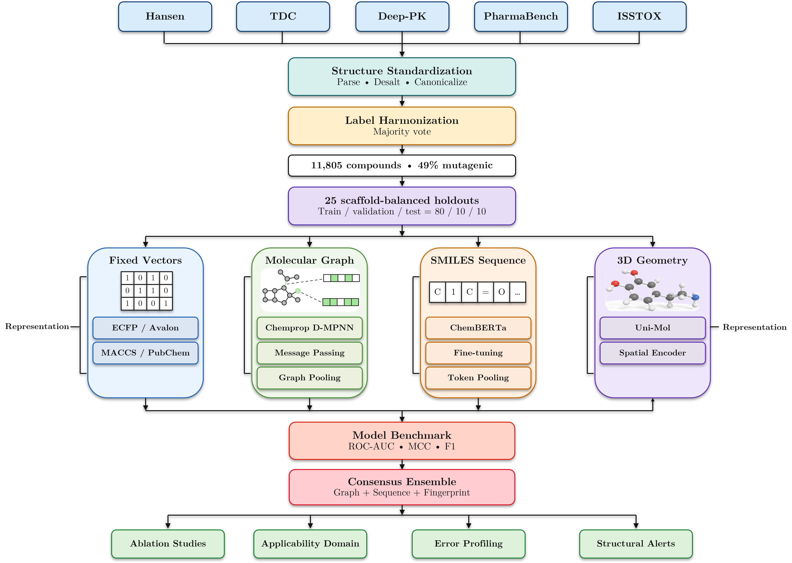

# From Fingerprints to 3D Structure-Aware Transformers for Ames Mutagenicity Prediction


> **🚧 The associated manuscript is currently under review.**

Code, harmonized datasets, and reproduction scripts for:  

> **"From Fingerprints to 3D Structure-Aware Transformers: Evaluating Ames Mutagenicity Modeling Pipelines under Repeated Scaffold-Balanced Evaluation"**



**Figure 1.** *Study workflow. Five public datasets were standardized and merged using majority voting. Models were trained using 25 repeated scaffold splits, followed by post-hoc rank tests, error profiling, and structural alert analysis.*

---

## Overview

Ames mutagenicity is one of the standard first-line safety assays in drug discovery. While deep learning models and 3D transformers are frequently proposed for this task, published benchmarks often rely on a single random split, compare models across mismatched datasets, or pair complex architectures against un-tuned baselines.

This repository benchmarks 10 modeling pipelines across 5 representation families on a harmonized set of **11,805 unique compounds**:

- **Dataset:** Hansen, TDC, Deep-PK, PharmaBench, and ISSTOX, standardized with canonical SMILES, InChI, and InChIKeys.
- **Evaluation:** 25 repeated 80/10/10 Bemis–Murcko scaffold-balanced splits ($N_{\text{test}} = 1,180$ per split). All cyclic scaffolds in the test set are unseen during training.
- **Model families:** Molecular fingerprints (MLP, Random Forest, Gradient Boosting), Chemprop D-MPNNs (atom and bond message passing), ChemBERTa language models (MLM and MTR pretraining), Uni-Mol 3D transformers (v1 and v2), and cross-representation ensembles.

---

## Pipelines Results

Mean and sample standard deviation across 25 repeated scaffold-balanced splits ($N_{\text{test}} = 1,180$ per split):


| Model family       | Pipeline                          | ROC-AUC (%)      | Accuracy (%)     | F1-Score (%)     | MCC               |
| :------------------ | :--------------------------------- | :----------------: | :----------------: | :----------------: | :-----------------: |
| **Ensemble**       | **Cross-representation ensemble** | **87.82 ± 1.43** | **80.49 ± 1.78** | **80.41 ± 2.70** | **0.609 ± 0.035** |
| **3D Transformer** | **Uni-Mol v2 (fine-tuned)**       | **87.57 ± 2.25** | **80.08 ± 2.74** | **79.82 ± 4.21** | **0.603 ± 0.052** |
| 3D Transformer     | Uni-Mol v1 (fine-tuned)           | 86.69 ± 1.94     | 79.22 ± 2.14     | 78.28 ± 3.38     | 0.587 ± 0.042     |
| **GNN**            | **Bond D-MPNN (normalized)**      | **86.82 ± 1.99** | **79.47 ± 2.12** | **79.57 ± 3.30** | **0.589 ± 0.042** |
| GNN                | Atom D-MPNN (normalized)          | 86.42 ± 1.82     | 79.38 ± 1.99     | 79.43 ± 3.09     | 0.588 ± 0.038     |
| **Language model** | **ChemBERTa-77M MTR (mean)**      | **85.44 ± 1.70** | **78.62 ± 1.82** | **78.58 ± 2.92** | **0.571 ± 0.036** |
| Language model     | ChemBERTa-77M MLM (mean)          | 84.21 ± 1.98     | 77.17 ± 1.96     | 76.70 ± 3.38     | 0.543 ± 0.039     |
| **Fingerprint**    | PubChem (881 bits) + GB (tuned)   | 85.88 ± 1.74     | 78.63 ± 2.10     | 78.26 ± 2.98     | 0.572 ± 0.041     |
| Fingerprint        | MACCS (166 keys) + RF (tuned)     | 85.05 ± 2.07     | 77.10 ± 1.96     | 76.99 ± 2.76     | 0.540 ± 0.039     |
| Fingerprint        | MACCS (166 keys) + MLP            | 84.67 ± 1.97     | 76.98 ± 1.97     | 77.04 ± 2.28     | 0.538 ± 0.039     |
| Fingerprint        | ECFP4 (1,024 bits) + MLP          | 82.47 ± 1.73     | 74.96 ± 1.90     | 74.68 ± 3.52     | 0.498 ± 0.036     |


A few takeaways from these numbers:

1. **The top two models are statistical equals:** The ensemble's $+0.26\%$ edge over Uni-Mol v2 is not statistically significant once you correct for fold overlap ($t(24) = 0.47, p = 0.641$; Wilcoxon $W = 155.0, p = 0.853$). The win record across splits is 12 for the ensemble and 13 for Uni-Mol v2.
2. **Ensembling narrows the spread:** The ensemble's real advantage is stability. Its test ROC-AUC standard deviation is $1.43\%$, compared to $2.25\%$ for Uni-Mol v2, and its worst fold dropped to $83.8\%$ versus $80.3\%$ for Uni-Mol v2.
3. **Tuned tree baselines confirm representation limits:** Hyperparameter-tuned tree ensembles (Random Forest and Gradient Boosting) reach at most $85.88 \pm 1.74\%$ ROC-AUC (PubChem Gradient Boosting) and $85.05 \pm 2.07\%$ (MACCS Random Forest; Supporting Information Table S4). This demonstrates that fixed MLP baselines ($82.47\%–85.14\%$) adequately capture the ceiling of 2D fingerprint features, while remaining below learned graph ($86.82\%$), 3D transformer ($87.57\%$), and ensemble ($87.82\%$) models.

---

## Dataset and partition protocol

See [`data/README.md`](data/README.md) for full details on sources, standardization, and combine rules.

---

## Citation

If you find this benchmark or dataset useful, please cite:

```bibtex
@article{mazraedoost2026toxames,
  title={From Fingerprints to 3D Structure-Aware Transformers: Evaluating Ames Mutagenicity Modeling Pipelines under Repeated Scaffold-Balanced Evaluation},
  author={},
  journal={},
  year={},
  doi={}
}
```

Additionally, if you use any constituent dataset included in this repository, please respect its original license policy and cite the respective primary publication (see [`data/README.md`](data/README.md) for full citation details and references).

---

## License

Code is licensed under the [MIT License](LICENSE). 